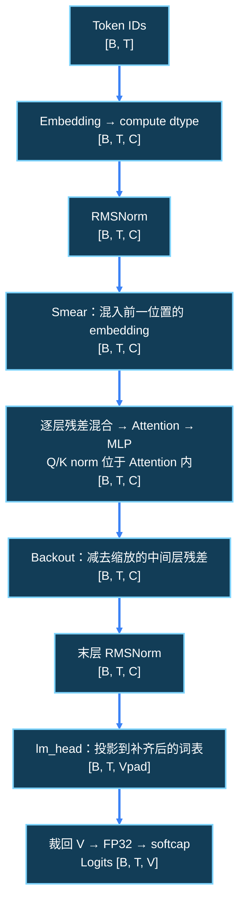

---
source_files:
  - nanochat/gpt.py
  - nanochat/common.py
  - nanochat/flash_attention.py
  - .agents/docs/career_roadmap/w1/scripts/d04_probe_model_and_cache.py
source_symbols:
  - GPTConfig
  - norm
  - CausalSelfAttention.forward
  - Block.forward
  - GPT.forward
  - GPT.generate
doc_type: tutorial
knowledge_scope: W1 D4 无缓存模型路径和张量形状
---

# W1 D4：从 token ID 推导到下一 token 的分数

D3 用替身隔离了 Engine 控制流。今天打开真实 GPT 的计算链，回答：“一串整数怎样变成整个词表的预测分数？”先跟着固定小尺寸推演，再用 CPU 上的随机小 GPT 对照。预计 90 分钟；无需 GPU、已有 checkpoint、训练数据或下载。

**第 1–4 节是阅读与纸面推演，没有运行模型的要求；第 5 节才是实际 CPU 操作。** CPU 脚本确实执行真实 GPT 的张量运算，权重和输入随机生成，不是生成器模拟。随机初始化是给参数填初值；训练还需依据目标误差更新参数，今天不做这一过程。随机模型结果只用于检查接口、形状与有限数值，不能衡量语言质量或训练好模型的性能。

前置：[D3 测试](d03_inference_smoke.md)。

## 当天的流程阅读

先用约 10–20 分钟阅读，再回到本篇；不新增手写报告或实验产物。

- **阅读入口**：[6.1 先理解基本前向](../../llm-training-workflow/06-forward-pass-and-prediction-loss.md#reading-6-1)；[6.2 注意力方向、窗口与 RoPE](../../llm-training-workflow/06-forward-pass-and-prediction-loss.md#reading-6-2)。
- **今天重点**：沿 `[B,T] → [B,T,C] → [B,T,V]` 理解每个轴的含义；认识注意力为何只能读当前位置及之前的信息。
- **暂时跳过**：Smear、Value Embedding、Backout 只识别位置和形状影响，不要求机制推导或训练效果分析；损失和目标对齐在 D9–D10 学习。

**读完能解释**：在哪一步整数变为向量，在哪一步得到每个候选 token 的分数？

## 1. 用同一组尺寸理解“整数变成向量”（概念推演）

本篇统一使用 `B=1,T=8,C=64,Hq=4,Hkv=2,Dh=16,V=128,L=2`，与第 5 节脚本默认配置一致。`B` 是样本数，`T` 是本次输入位置数，`C` 是每个位置的表示宽度，`V` 是有效词表大小，`L` 是 block 数；`Hq/Hkv` 和 `Dh` 在第 2 节拆开解释。

假设输入是 `[[5,9,5,12,3,6,8,2]]`。这些只是用于推演的合法 ID，不对应这里已知的文本，也不是脚本固定输入。输入形状为 `[1,8]`，表示一行、八个整数。ID 5 不代表“数值特征大小为 5”，它是查表的索引。

[GPT.forward](../../../../nanochat/gpt.py) 先做：

```python
x = self.transformer.wte(idx)
x = x.to(COMPUTE_DTYPE)
x = norm(x)
```

`wte` 是 <abbr title="embedding · 嵌入查表。每个词表 ID 对应一行可学习向量；输入整数用作索引，输出相应向量。相同 ID 在位置混合前查得相同向量。">embedding</abbr>：表中每行有 64 个浮点数。输入的每个整数换成一行向量，于是 `[1,8] → [1,8,64]`。两个 ID 5 最初查得相同向量，之后位置和上下文计算会使它们的表示不同。`to` 改变计算数据类型，`norm` 调整最后一维的数值尺度，均不改变形状。

这里的 <abbr title="RMSNorm / Root Mean Square Normalization · 均方根归一化。按向量最后一维的均方根缩放数值，帮助控制表示的尺度。项目的 norm 调用没有可学习的缩放参数，且保持输入形状。">RMSNorm</abbr> 由 `F.rms_norm(x, (x.size(-1),))` 实现；调用没有显式指定 epsilon，不应推定它与其他实现采用相同常数。模型还有大量其他可学习参数，不能从“norm 无参数”推出“模型无参数”。

“前向”就是用现有参数从输入算到输出；即使参数随机，这条计算链也可以执行。源码某个无缓存分支注释写着 `Training`，也不表示阅读或调用它就会训练。

## 2. 为什么要投影成 Q/K/V，再拆成多头

现在有八个位置的 64 维表示。注意力需要让一个位置按相关程度读取之前位置的信息：<abbr title="Q/K/V / Query, Key, Value · 查询、键和值。Q 与 K 的匹配产生读取权重，再用这些权重汇总 V；它们来自当前表示的不同投影，不是三份原始文本。">Q/K/V</abbr> 分别用于“当前想找什么”“每个位置用什么参与匹配”“匹配后实际读取什么内容”。这些只是帮助理解的角色描述，真正运算是不同线性投影和加权汇总。

[CausalSelfAttention.forward](../../../../nanochat/gpt.py) 的核心语句为：

```python
B, T, C = x.size()
q = self.c_q(x).view(B, T, self.n_head, self.head_dim)
k = self.c_k(x).view(B, T, self.n_kv_head, self.head_dim)
v = self.c_v(x).view(B, T, self.n_kv_head, self.head_dim)
```

先分开看两个动作。`c_q` 是线性层，把每个位置的 64 维向量映射到 `Hq×Dh` 维；`view` 再把末维拆成“头数、每头宽度”。它不增加元素，也不把不同 token 混起来。

本例 `Dh=C/Hq=64/4=16`：

| 步骤 | 尺寸推导 | 结果形状 |
|---|---|---|
| Q 线性投影 | 每位置输出 `4×16=64` 个数 | `[1,8,64]` |
| Q 拆头 | 最后一维 `64 → 4×16` | `[1,8,4,16]` |
| K、V 各自投影 | 每位置输出 `2×16=32` 个数 | 各 `[1,8,32]` |
| K、V 各自拆头 | 最后一维 `32 → 2×16` | 各 `[1,8,2,16]` |

比如 Q 在某个位置的通道 0–15 属于头 0，16–31 属于头 1，依次类推。`[1,8,32]` 中的 32 代表 K/V 两个头合起来的宽度，不能称为每头宽度。<abbr title="tensor shape · 张量每个轴的长度。这里依次标出样本、位置、头数和每头通道；相同数字处于不同轴时不能视为相同语义。">形状</abbr>必须连同轴含义一起读。

为什么 Q 有 4 个头，K/V 只有 2 个？本项目支持 <abbr title="GQA / Grouped-Query Attention · 分组查询注意力。多组 Query heads 共享较少的 Key/Value heads，以减少 K/V 表示及缓存体积；输出仍按 Query 头数组织。">GQA</abbr>。本例两个 Q 头共用一个 K/V 头：Q 头 0、1 共享 K/V 头 0；Q 头 2、3 共享 K/V 头 1。各 Q 头仍有自己的查询，因此可产生不同读取权重；共享 K/V 不等于输出四个头都相同。配置必须满足 `C % Hq == 0`、`Hq % Hkv == 0` 且 `Hkv <= Hq`，源码中有相应断言。

## 3. 注意力怎样汇总信息，又怎样回到 64 维

### 3.1 先补上位置与因果方向

Q/K 投影后，源码继续：

```python
q, k = apply_rotary_emb(q, cos, sin), apply_rotary_emb(k, cos, sin)
q, k = norm(q), norm(k)
q = q * 1.2
k = k * 1.2
```

<abbr title="RoPE / Rotary Position Embedding · 旋转位置编码。根据位置旋转 Q/K 的成对通道，使两者的匹配可利用相对位置信息；本文实现将末维拆成两半进行配对旋转，不改变形状。">RoPE</abbr> 给 Q/K 的匹配加入位置信息，位置不同会使用不同旋转；它不是往 token embedding 上另加一个位置向量。Q/K norm 控制每头最后一维的尺度，乘 1.2 再调整匹配尺度。它们都不改变表中形状，但“调整尺度”和“表达位置关系”用途不同，不能互相替代。

注意力先由 Q 与 K 的匹配得到各位置分数，经缩放、遮罩和 softmax 后得到权重，再用权重汇总 V。当前配置是全上下文的因果注意力：位置 2（从 0 编号）只能读位置 0、1、2，不能读 3–7。否则模型在预测后续内容时会读到未来信息。

下面是**人为给定权重的算术例子**，不声称来自脚本输出：某个 Q 头在位置 2 对三个允许位置的权重为 `[0.2,0.3,0.5]`，其共享 V 头在这三个位置的第一个通道分别为 `[2,4,8]`。该输出通道为 `0.2×2+0.3×4+0.5×8=5.6`。其余 15 个通道分别做相同加权；一个头输出 16 个数，四个 Q 头合起来仍为 64 个数。权重是在**位置轴**上分配，输出并没有保留一个额外“所有历史位置”轴。

### 3.2 布局改变不等于内容增加

无缓存时源码调用并合并结果：

```python
y = flash_attn.flash_attn_func(q, k, v, causal=True, window_size=window_size)
y = y.contiguous().view(B, T, -1)
y = self.c_proj(y)
```

输出先为 `[1,8,4,16]`，按 Q 头数组织；合并 `4×16` 后为 `[1,8,64]`，`c_proj` 再把四个头的信息线性混合到残差通道。即使 K/V 只有两个头，输出仍有四个 Q 头，而不是 `[1,8,2,16]`。

CPU 上 [flash_attention.py](../../../../nanochat/flash_attention.py) 将输入从 `[B,T,H,Dh]` 转成 PyTorch SDPA 的 `[B,H,T,Dh]`，计算后转回来。本例 Q 的内部布局为 `[1,4,8,16]`，不是多了数据，只是交换“位置”和“头”两轴；`enable_gqa` 处理 Q 与 K/V 头数差异。这里的 <abbr title="SDPA / Scaled Dot Product Attention · 缩放点积注意力。本文指 nanochat 回退分支调用的 PyTorch 接口；CPU 路线不执行 Flash Attention 3 内核。">SDPA</abbr> 计算是真实注意力计算。

特定层还会把 Value Embedding 通过 gate 混入 V，所以实际 V 不始终等于 `c_v(x)`。今天只确认这一项保持 `[B,T,Hkv,Dh]`，不用推导其训练效果。

## 4. 从注意力输出走到词表分数

### 4.1 为什么 block 输入和输出必须一样宽

[Block.forward](../../../../nanochat/gpt.py) 为：

```python
x = x + self.attn(norm(x), ve, cos_sin, window_size, kv_cache)
x = x + self.mlp(norm(x))
```

<abbr title="residual connection · 残差连接。保留当前表示，并把一个子层计算出的修正逐元素相加；相加双方必须具有可对应的维度。">残差连接</abbr>把原来的表示保留下来，再叠加注意力提供的上下文信息。因此 attention 必须回到 `[1,8,64]`，才能和 `x` 对应相加。

接着 <abbr title="MLP / Multi-Layer Perceptron · 多层感知机。此处对每个位置独立做通道映射，先扩到四倍宽，经 ReLU 平方激活后压回原宽度；不负责跨位置读取信息。">MLP</abbr> 做 `[1,8,64] → [1,8,256] → [1,8,64]`，中间用 `F.relu(x).square()`，再经第二个残差加法。注意力负责跨位置汇总，MLP 负责每个位置的通道变换；二者输出形状相同，但处理信息的方式不同。两层 block 不会把 T 变为 16，层数不是输入长度。

完整 GPT 在 block 之外还有初始 embedding 的 Smear、各层的残差系数和 Backout。它们保持 `[B,T,C]`，今天只在源码中识别位置；下面保留原图供回查，不把这些机制列为必答推导。

### 4.2 64 个表示通道怎样成为 128 个候选分数

[GPT.forward](../../../../nanochat/gpt.py) 的最终片段为：

```python
logits = self.lm_head(x)
logits = logits[..., :self.config.vocab_size]
logits = logits.float()
logits = softcap * torch.tanh(logits / softcap)
```

末层 norm 后的每个 64 维向量经过 `lm_head`，得到词表候选的分数。模型内部先把词表大小补齐到 64 的倍数，记为 `Vpad`，然后裁回真实 `V`。本例 `V=128` 已对齐，所以 `[1,8,64] → [1,8,128]`，裁剪前后一样大；这并不表示所有配置都不需要裁剪。

<abbr title="logits · 模型输出的未归一化预测分数，每个有效词表项对应一个分数。它们不是概率，总和无需为 1；采样时通常再用 softmax 转成概率。">logits</abbr> 转成 FP32 后使用 `softcap=15` 的平滑限制：`15*tanh(logits/15)`，形状不变，数值幅度受到约束。`model(ids)` 不传 targets 时返回 `[B,T,V]`；若传 targets，当前 forward 返回交叉熵损失，不能仍按三维 logits 解读它。

为什么有八组词表分数，却只生成一个下一 token？每个位置输出对其后续 token 的预测分数；续写时取**最后输入位置**的 128 个分数，得到前缀之后那个 token。`128` 是候选数，不是一次输出 128 个 token。

无缓存的 [GPT.generate](../../../../nanochat/gpt.py) 接下来执行：

```python
logits = self.forward(ids)
logits = logits[:, -1, :]
# 按 temperature/top_k 选择 next_ids 后：
ids = torch.cat((ids, next_ids), dim=1)
```

初始长度 8，连续生成三个 token 时，三次 forward 的输入长度分别为 8、9、10：预测一个再拼回前缀，供下一次计算。这条路径每步重算历史，不使用 KV Cache；D5 学习怎样复用历史计算。今天 CPU 脚本只做一次前向，并不运行这三步生成。

## 5. 用 CPU 随机 GPT 核查以上推导（实际操作）

[随机模型与缓存探查脚本](scripts/d04_probe_model_and_cache.py) 的 `--mode shapes` 会创建两层随机 GPT 和随机 ID、执行一次真实前向，通过 <abbr title="forward hook · 前向钩子。注册到模块的观察函数，在该模块执行后读取输入和输出；本脚本只记录形状，不修改模块计算。">forward hook</abbr> 记录 embedding、第一层 Q/K/V、block 和 lm_head 的形状。它在导入前隐藏 CUDA、固定 FP32、seed=42、单 CPU 线程，不读 checkpoint、不下载、不反向传播、不更新参数。

运行前先预测 JSON 中 Q 线性输出、K 线性输出与最终 logits 的三个形状，再执行：

```bash
cd /home/lizishuo/_program_/Project/nanochat
mkdir -p experiments/inference_infra/reports
{
python -c 'import sys; print(sys.executable)'
python .agents/docs/career_roadmap/w1/scripts/d04_probe_model_and_cache.py --mode shapes
d04_status=$?
printf 'shapes_probe_exit=%s\n' "$d04_status"
} > >(tee -a experiments/inference_infra/reports/d04_checks.log) 2>&1
```

默认写入 `experiments/inference_infra/results/w1/d04_shapes_probe.json`，同名结果会被重写；需保留旧证据时，改用 `--output` 指定新路径，并在交流中注明真实输出位置。只在导入及全部断言成功后写结果；若失败，即使有旧同名 JSON，也不能当成本次成功。

| 本次应检查的字段 | 与概念推导怎样对应 |
|---|---|
| `config` | 实际 C/Hq/Hkv/V 是否为上文默认值，不能先套表再忽略配置 |
| `shapes` 中 `transformer.wte` | 输入 `[1,8]`，输出 `[1,8,64]`，核对整数查表变为向量 |
| `shapes` 中 `...attn.c_q/c_k/c_v` | Q `[1,8,64]`、K/V `[1,8,32]`；钩子位于线性层，尚未经过 view |
| `logits_shape` | `[1,8,128]`；若指定不同 `--prompt-tokens`，位置轴随之变化 |
| `logits_dtype`、`USE_FA3` | 预期 FP32、false，说明这次使用 CPU 回退路径 |

这些是运行契约的预期，不是预填的实测。先将真实输出和自己的预测比较：若把 K 写成 `[1,8,2,16]`，并不一定是脚本错误，可能是把线性层钩子误当成拆头之后。需沿源码确认观察点，而非只比较数字是否相同。

脚本还检查 logits 全部为有限数值：正确形状仍可能装着 NaN/Inf，不能只看形状就认可计算。它将默认初始化为零的 attention/MLP 输出投影改成非零随机值，并启用非零 smear 系数，让后续 D5 缓存探查不容易被零贡献掩盖。填随机值属于设置实验输入，仍不是学习参数的训练过程。

目前配置保留 `C=64`，不要为了更小随意改成 16：当前 Smear gate 读取前 24 个通道；RoPE 也要求每头通道能成对拆分。无缓存 forward 断言 `T>1`，所以 `--prompt-tokens` 至少 2；脚本还要求 `steps>=1`、`P+steps<=64`，即使 shapes 模式也会检查这些参数。

| 失败表现 | 沿哪条证据定位 |
|---|---|
| `DEPENDENCY_MISSING` | 核对 D2 的解释器和缺失模块，不下载模型来修依赖 |
| `T>1` 或参数错误 | 核对 `--prompt-tokens` 与脚本参数约束，不绕开断言 |
| dtype 不符 | 变量需在模块导入前生效；检查当前进程，不沿用旧导入状态 |
| shape 不一致 | 先检查实际 config，再区分线性输出、拆头与内部 transpose |
| NaN/Inf | 保留错误和 seed，不能用无效数值继续声称计算正确 |

## 6. 五个自验证与交流问题

直接按题号在聊天中回答；实测题附一次命令、退出码和 JSON 路径即可。未做 CPU 操作时说明缺少本次运行证据；不要求写报告，不以训练或 GPU 实验补证。

1. **整数、向量与分数**：对本文八个 ID，解释 `[1,8] → [1,8,64] → [1,8,128]` 每个轴。为何两个 ID 5 先查得相同向量，后面却可以有不同表示？

   **核对要点**：区分索引、表示宽度和候选词表；能联系位置与上下文处理，不需展开高级机制。

2. **改变头数**：保持 `C=64,Hq=4`，把 `Hkv` 从 2 改成 1，Q/K/V 的线性输出和多头布局各怎样变化？为什么 attention 仍须回到 64 维？

   **核对要点**：自行推导每头宽度、GQA 共享和输出合并，不把 K/V 总宽当成每头宽度。

3. **信息如何汇总**：对位置 2，若允许位置的权重变为 `[0.5,0.5,0]`、V 第一个通道仍为 `[2,4,8]`，该输出通道是多少？为何位置 7 不参与？RMSNorm 为什么不能代替这一因果限制或 RoPE？

   **核对要点**：能做加权汇总，区分数值尺度、允许读取范围与位置关系，不要求 RoPE 公式推导。

4. **一次前向与连续生成**：为什么 `[1,8,128]` 不能解释成“生成了 8×128 个 token”？从长度 8 续写三次，哪些分数用来选 token，何时追加 ID？

   **核对要点**：区分位置预测与词表候选，沿 forward→末位置→采样→拼接推导输入长度；传 targets 的返回值要另行解读。

5. **用实际证据修正预测**：选本次 JSON 一条钩子记录与最终输出，说明它们是否符合你的推导。若最终形状正确却含 Inf，你能接受吗？随机权重探查能支持什么结论？

   **核对要点**：定位真实观察点，区分形状、有限值、功能路径与语言质量；没有运行不编造实际结果。

## 7. 完整前向图与脚本产物回查

下图表示无缓存、`T>1`、不传 targets 的完整 forward；对暂缓机制只需知道位置和形状，无需重新绘图。



`Vpad` 是补齐后的内部词表大小，最终输出裁回实际 `V`。图中的“Smear→逐层混合→Backout”保持 `[B,T,C]`，不能据此认为各自作用相同。

| 脚本完整路径 | 阶段、输入和条件 |
|---|---|
| [`.agents/docs/career_roadmap/w1/scripts/d04_probe_model_and_cache.py`](scripts/d04_probe_model_and_cache.py) | 第 5 节 `--mode shapes`；调用 `nanochat/gpt.py`、`nanochat/engine.py`、`nanochat/flash_attention.py`，内部随机权重/ID，无外部数据输入；需项目依赖可导入，CPU/FP32，P≥2、steps≥1、P+steps≤64 |

| 完整项目相对路径 | 用途、生成者与条件 |
|---|---|
| `experiments/inference_infra/results/w1/d04_shapes_probe.json` | 探查脚本 `--mode shapes` 全部断言成功后自动写入的形状、配置和后端事实；指定 `--output` 时写该参数路径 |
| `experiments/inference_infra/reports/d04_checks.log` | 第 5 节命令组通过 tee 自动追加的实际输出、错误和即时退出码 |
| `experiments/inference_infra/reports/d04_model_path.md` | 可选人工整理形状链和聊天证据，不影响本日完成 |

清单不是已生成声明；历史文件和外部证据保留原名，不倒填当天运行。<abbr title="JSON / JavaScript Object Notation · 用键值与数组保存结构化数据的文本格式；本文文件保存探查脚本采集到的真实形状和配置。">JSON</abbr> 中已有的事实无需抄成报告。

命令用局部 <abbr title="Bash process substitution · 进程替换。命令组的输出交给 tee 同时显示与追加日志，组结束后终端恢复正常，不持续记录提示符。">进程替换</abbr>，复制时保留完整花括号与末尾重定向；`$?` 紧跟探查命令保存，随后 `printf` 的成功状态不代表探查成功，以打印值为准。旧终端若仍有全局重定向，应关闭后新开，文档修改不会终止原有重定向。

本日完成标准是能推导主链和多头布局，并解释实际 CPU 探查的证据范围；依赖阻塞须说明尚未运行。无需 GPU 或训练好的权重，也不把可选硬件扩展记成欠账。

上一篇：[D3 推理测试](d03_inference_smoke.md)。下一篇：[D5 缓存生命周期](d05_cache_lifecycle.md)。
