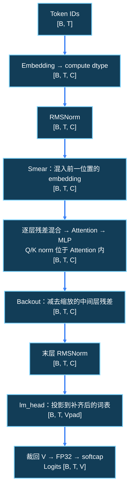

---
source_files:
  - nanochat/gpt.py
  - nanochat/common.py
  - nanochat/optim.py
source_symbols:
  - GPTConfig
  - norm
  - CausalSelfAttention.forward
  - GPT.forward
  - GPT.generate
doc_type: tutorial
knowledge_scope: W1 D4 无缓存模型路径和张量形状
---

# W1 D4：从 token ID 走到 logits

今天完成一张能自己讲出来的形状图，并用随机小模型核查。预计 90 分钟：15 分钟配置，25 分钟注意力，20 分钟完整 forward，15 分钟脚本，15 分钟核验问题。进阶阅读可另加 30 分钟，不挤掉验收。

前置：[D3 测试](d03_inference_smoke.md)。只使用随机权重，不要等待真实 checkpoint。随机权重能验证接口和形状，不能衡量语言质量或实际模型性能。

## 当天的流程阅读

先用约 10–20 分钟读下面指定的小节，再回到当天操作；已读内容按问题回查即可。阅读只需口述理解，不新增手写报告或实验产物。

- **阅读入口**：[6.1 先理解基本前向](../../llm-training-workflow/06-forward-pass-and-prediction-loss.md#reading-6-1)；[6.2 注意力方向、窗口与RoPE](../../llm-training-workflow/06-forward-pass-and-prediction-loss.md#reading-6-2)。
- **今天重点**：先沿 [B,T] → [B,T,C] → [B,T,V] 走通，再对照完整形状表认识注意力和前馈层。注意力小节先掌握因果方向与窗口。
- **暂时跳过**：Smear、Value Embedding、Backout 先标出位置，不要求推导；损失和目标对齐在 D9–D10 补读。

**读完能解释**：模型在哪一步从整数变成向量，又在哪一步得到整个词表的预测分数？可直接在聊天中回答，再用本日原有自验证问题核对实际实验。

## 当日脚本与产物清单

所有项目内路径均以 nanochat 项目根目录为基准；外部 MiniMind 只读历史证据不改名。`dNN_` 表示全程首次使用或产生日，跨日复用不改前缀；上游源码和测试保留原生名称。

| 角色与脚本 | 用途与执行阶段 | 输入路径或来源 | 运行条件 |
|---|---|---|---|
| 入口：[`.agents/docs/career_roadmap/w1/scripts/d04_probe_model_and_cache.py`](scripts/d04_probe_model_and_cache.py) | 第 4 节 `--mode shapes` 验证张量链路 | `nanochat/gpt.py`、`nanochat/engine.py`、`nanochat/flash_attention.py`；脚本内部随机 token/权重，无外部数据文件 | 项目依赖可导入；CPU/FP32，P≥2、steps≥1、P+steps≤64 |

| 完整项目相对路径 | 用途 | 生成者 | 生成方式与条件 |
|---|---|---|---|
| `experiments/inference_infra/results/w1/d04_shapes_probe.json` | 随机模型形状和后端事实 | `d04_probe_model_and_cache.py --mode shapes` | 条件生成：导入和全部断言成功后自动写入 |
| `experiments/inference_infra/reports/d04_model_path.md` | 形状链、源码图与运行证据 | 第 5 节问答可选整理 | 可选人工整理；直接聊天回答即可，不影响验收 |
| `experiments/inference_infra/reports/d04_checks.log` | 本日终端检查输出与错误 | 各 Bash 代码块的 tee | 自动追加各代码块内的输出；命令及退出码在交流时补充 |

清单是执行后的预期，不表示文件已经存在。已有未加前缀的历史实验文件保留，新执行按上述路径写入。

正文的 `sed`、`rg`、`head`、解释器检查等只向终端打印，不会自动生成独立结果文件；各 Bash 代码块内的输出追加保存到 `experiments/inference_infra/reports/d04_checks.log`；交流时附所用命令、退出码和关键结果，自动结果已有的字段无需手抄。 盘点或探查的结构化结果保存为 <abbr title="JSON / JavaScript Object Notation · 用键值和数组组织数据的文本格式；这里保存脚本实际采集的事实或断言通过后的结果，可供程序读取。">JSON</abbr>。 未执行或失败时按真实状态记录，不能把旧同名文件当作本次成功。

## 1. 建立符号与尺寸的对应

日志只在 `{ ...; }` 命令组执行期间记录；<abbr title="Bash process substitution · 进程替换。这里把命令组的输出交给 tee，同时显示并追加到日志；重定向在命令组结束后恢复。">进程替换</abbr>不会持续接管交互终端，因此提示符和 VS Code 终端集成控制字符不会混入日志。命令组在当前 shell 执行，变量设置会保留；代码块返回最后一条命令的退出码，需核对单条命令时立即记录 `$?`。已有的显式文件重定向仍写入各自文件。复制时包含外层花括号和末尾重定向。若之前执行过旧版全局日志命令，先关闭旧终端并新开终端；仅修改文档不会停止旧终端的记录。

```bash
cd /home/lizishuo/_program_/Project/nanochat
mkdir -p experiments/inference_infra/reports
{
rg -n '^class GPTConfig|^def norm|^class CausalSelfAttention|^class Block|def forward|def generate' nanochat/gpt.py
sed -n '25,160p' nanochat/gpt.py
} > >(tee -a experiments/inference_infra/reports/d04_checks.log) 2>&1
```

先确认 `B=批量大小，T=本次输入长度，C=n_embd，Hq=n_head，Hkv=n_kv_head，Dh=C/Hq，V=词表大小`。<abbr title="tensor shape · 张量每个轴的长度。相同数字在不同轴代表不同含义；例如 T 是当前输入长度，Tmax 是缓存容量，两者不能混用。">shape</abbr> 既要记数字，也要记轴含义。

脚本固定 `B=1,T=8,C=64,Hq=4,Hkv=2,Dh=16,V=128,L=2`，足够小且满足整除要求。不能任意改成 `C=16`，当前 smear gate 要读取前 24 个通道，极小配置可能不合法。head dim 同时要兼容当前旋转位置编码的成对拆分。

## 2. 读 norm 与注意力，不跳过布局

`norm(x)` 调用 `F.rms_norm(x, (x.size(-1),))`。<abbr title="RMSNorm / Root Mean Square Normalization · 按最后一维的均方根缩放输入。此项目没有可学习的归一化权重，epsilon 未在调用处显式指定，不能擅自声称与另一个实现的常数完全相同。">RMSNorm</abbr> 保持 shape；这里没有可学习 norm 参数，但不能据此说整个模型无参数。

按 `CausalSelfAttention.forward` 的顺序核对下面形状表，无需重画：

| 节点 | 形状 | 你要注意的事 |
|---|---|---|
| 残差输入 | `[1,8,64]` | B、T、C |
| `c_q` 后 | `[1,8,64]` | 下一步 view 为 `[1,8,4,16]` |
| `c_k/c_v` 后 | `[1,8,32]` | view 为 `[1,8,2,16]` |
| RoPE 与 Q/K norm 后 | Q `[1,8,4,16]`；K `[1,8,2,16]` | 轴不变；Q/K 各乘 1.2 |
| attention 输出 | `[1,8,4,16]` | 回退内部会 transpose |
| 合并 heads 与投影 | `[1,8,64]` | 返回残差通道 |

<abbr title="GQA / Grouped-Query Attention · 分组查询注意力。多组 Query heads 共享较少的 Key/Value heads，本文 Hq=4、Hkv=2；缓存按 Hkv 存储，不按 Hq 存储。">GQA</abbr> 解释了 K/V 比 Q 窄。<abbr title="RoPE / Rotary Position Embedding · 旋转位置编码。对 Q 和 K 的通道对做随位置变化的旋转，使注意力利用相对位置信息；这里不改变张量尺寸。">RoPE</abbr> 不是独立加在 token embedding 上的位置向量。

Value embedding 会在特定层通过 gate 混入 V；不要把 `c_v(x)` 当作 V 的全部来源。第一次阅读只标出混入位置，不需要今天推导训练效果。

## 3. 沿 GPT.forward 走一遍完整链路

```bash
{
sed -n '460,565p' nanochat/gpt.py
} > >(tee -a experiments/inference_infra/reports/d04_checks.log) 2>&1
```

沿下面顺序核对，可直接口述：

1. 整数 ID `[B,T]` 查 embedding 得 `[B,T,C]`，转 compute dtype，再 norm。
2. smear 混合相邻 token embedding。无 cache 时通过切片读取前一个位置，因此当前代码断言 `T>1`。本教程用 P=8；不能用单 token 无缓存输入作为本版本的通过条件。
3. 每层先结合 `resid_lambdas`、`x0_lambdas`，再 attention 和 MLP；形状仍 `[B,T,C]`。
4. 中间层残差参与 backout；末层 norm 后，`lm_head` 输出 padded vocab，再裁回 `V`。
5. logits 转 FP32、经过 `15*tanh(logits/15)` softcap。<abbr title="softcap · 用平滑函数限制分数幅度。此处最终分数被压到接近正负 15 的范围，数值不再是裸线性投影输出。">softcap</abbr> 不改变 `[B,T,V]`。
6. 不传 targets 返回 logits；传 targets 返回交叉熵损失，不能仍按三维 logits 解读返回值。

`GPT.generate` 每次把完整已生成前缀重新传入 forward，只取最后一个位置分数选下一 token，再拼回前缀；它是无缓存、自回归、batch=1 路径。

## 4. 用脚本验证形状

打开[随机模型与缓存探查脚本](scripts/d04_probe_model_and_cache.py)，重点看 `GPTConfig`、`init_weights()` 和 `register_forward_hook()`：

```bash
{
python .agents/docs/career_roadmap/w1/scripts/d04_probe_model_and_cache.py --help
python .agents/docs/career_roadmap/w1/scripts/d04_probe_model_and_cache.py --mode shapes
} > >(tee -a experiments/inference_infra/reports/d04_checks.log) 2>&1
```

脚本在导入前隐藏 CUDA、固定 FP32、seed=42 和单 CPU 线程，避免 GPU 内核发现；不下载 tokenizer、数据或权重。默认输出 `experiments/inference_infra/results/w1/d04_shapes_probe.json`。

预期可检查的结构是 `logits_shape=[1,8,128]`、`logits_dtype=torch.float32`、`USE_FA3=false`。这是契约示例，不是预先填好的执行结果。`shapes` 的 c_q/c_k/c_v hook 截获的是线性层输出，尚未经过 view，所以 K/V 是 `[1,8,32]`；你需要根据源码补上 heads 轴。

脚本在初始化后给残差输出投影填入非零随机值，并启用非零 smear 系数。原因是 `init_weights()` 默认把部分输出投影置零，直接使用默认值可能让后续缓存错误被“零输出”掩盖。它依旧是随机功能实验，不是训练好的模型。

编写时验证记录：使用 Conda `nanochat` 的 Python 3.10.20 / torch 2.9.1+cpu 运行同一脚本，shape 与有限值断言通过，实际 logits 为 `[1,8,128]`、FP32、SDPA。该记录是交付脚本烟测，不替代你当天运行的原始结果。

## 5. 当天自验证与交流问题、失败处理及验收

可直接在聊天中按题号回答，不要求手写报告。每题给出结论和可定位依据（源码位置、命令与退出码、日志片段或自动结果字段）；同一份证据可复用。概念推演须注明假设，实际运行须区分本次与历史结果。未执行写 `PENDING`，失败写真实错误和影响范围，不能据此勾选实验通过。

1. **配置符号与合法性**：本次 B、T、C、Hq、Hkv、Dh、V、L 各是什么？怎样由 C/Hq 得到 Dh，Hq/Hkv 必须满足哪些整除关系？

   **通过标准**：引用探查配置和 `CausalSelfAttention.__init__`；逐项说明轴含义，区分 T 与缓存容量，不能只抄一串数字。

2. **整数到词表分数**：从 `[B,T]` 的 token ID 开始，依次写出 embedding、block、lm_head 和最终 logits 的形状；Vpad 与 V 在哪里分开？

   **通过标准**：对照 `GPT.forward` 及 hook 的实际模块名，说明查表后变向量、lm_head 投影到补齐词表、裁回实际 V；普通推理返回 `[B,T,V]`。

3. **Q/K/V 的线性层与多头布局**：在默认配置下，为什么 hook 的 Q 输出是 `[1,8,64]`、K/V 是 `[1,8,32]`？它们各如何 reshape，多头结果又如何合并回 C？

   **通过标准**：同时给出线性输出和 `[B,T,H,Dh]` 布局，并指出 hook 截获位置；用 Hq=4/Hkv=2 解释宽度，不将线性输出误写成多头输出。

4. **GQA 与注意力输出**：Query heads 与 K/V heads 为什么可以数量不同？注意力返回按 Hq 还是 Hkv 排列，哪种 head 数决定缓存存储？

   **通过标准**：结合注意力调用和 D4 形状表解释共享关系、输出和缓存轴；不因 K/V 较窄就认为残差通道也缩小。

5. **归一化与位置处理**：embedding norm、Q/K norm、RoPE 各作用于什么张量、位于哪一步，是否改变 shape？当前 RMSNorm 有无可学习权重？

   **通过标准**：指向 `norm`、`apply_rotary_emb` 与 attention 调用顺序，说明 RoPE 处理 Q/K 而非向 embedding 加位置向量；不杜撰 norm 的显式 epsilon。

6. **额外路径的位置**：smear、Value Embedding、残差混合与 backout 各在什么位置参与？为什么不能把 V 的来源只归结为 `c_v(x)`？

   **通过标准**：指出 smear 混入前一位置 embedding、Value Embedding 经 gate 混入 V、backout 在输出投影前处理残差；只需定位和 shape，不要求推导训练收益。

7. **返回值、精度与数值范围**：最终 logits 为什么是 FP32，softcap 做什么？传入 targets 时返回值如何改变，与 `[B,T,V]` 分数有什么区别？

   **通过标准**：引用 `.float()`、softcap 和交叉熵分支；说明形状链只适用于不传 targets，默认损失归约与 logits 返回不同，不能由 FP32 logits 断言所有计算都为 FP32。

8. **无缓存生成控制流**：`GPT.generate` 如何选最后位置的下一 token、拼接回输入？P=8 连续生成三次时，每次 forward 的输入长度是多少，为什么无缓存 T=1 在本版本不合法？

   **通过标准**：对照循环和 smear 的 T>1 断言推导长度；区分生成 token 与再次输入 token，不能把这个入口描述成单 token 缓存 decode。

9. **探查条件与区分能力**：脚本在哪设置 CPU、FP32、seed 和线程数？为什么在 `init_weights()` 后额外设置非零投影与 smear 系数，默认零投影可能掩盖什么？

   **通过标准**：引用探查脚本初始化顺序和模型初始化实现；说明是随机功能验证而非训练或性能实验，不由固定 seed 推断跨设备位级一致。

10. **实际结果与失败边界**：本次 JSON 的 `mode/config/seed/USE_FA3/logits_shape/logits_dtype/shapes` 是什么？有限值由哪个断言保证，是否真的有独立 JSON 布尔字段？

    **通过标准**：给出本次命令、退出码与输出路径，按真实字段答题，成功返回才支持脚本断言已执行；失败保留最早错误，旧 JSON 不作本次证据，GPU/质量仍未验证。

下图可直接用作核对辅助，无需重新绘制；它表示不传 targets、无缓存且 `T>1` 的 forward 路径：



`Vpad` 表示模型为对齐而补齐后的词表大小，`V` 是实际词表大小。交流时用本次具体尺寸解释上图符号；Attention 内部的 Q/K/V 布局参照第 2 节的表。不要将 hook 看到的线性层输出错标成多头布局。

| 失败 | 检查 |
|---|---|
| DEPENDENCY_MISSING | 返回 D2 确认依赖与解释器，保存错误 |
| T>1 断言 | 确认 `--prompt-tokens` 至少 2，不绕开断言 |
| dtype 断言 | 环境变量必须在导入前设置；新开进程重跑 |
| shape 不一致 | 先核对配置和线性层输出/reshape 的区别 |
| 有 NaN/Inf | 保留输出与 seed，不能用异常数值继续对比 |

验收：能从 `[B,T]` 推到 `[B,T,V]`；能说明 Hq/Hkv；真实运行成功或明确依赖阻塞；回答不含随机模型的质量结论。交流附实际日期、commit、命令、JSON 路径、状态和明日待办；用时可选。

上一篇：[D3 推理测试](d03_inference_smoke.md)。下一篇：[D5 缓存生命周期](d05_cache_lifecycle.md)。
