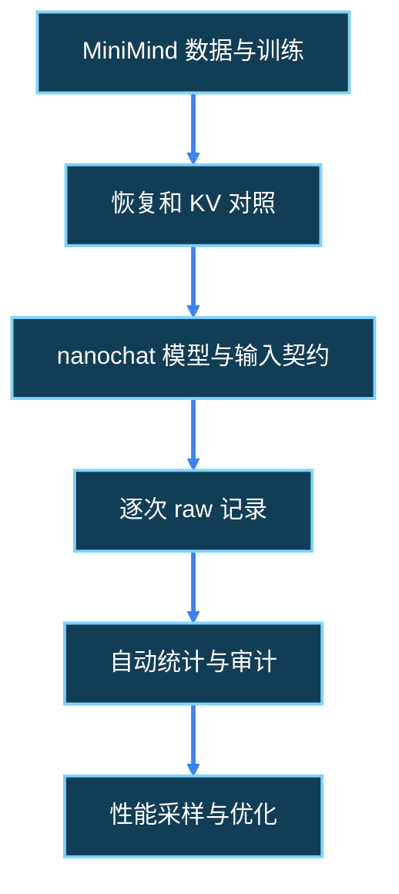

---
source_files:
  - nanochat/engine.py
  - nanochat/gpt.py
  - nanochat/checkpoint_manager.py
  - nanochat/flash_attention.py
  - scripts/infer_bench.py
  - tests/test_engine.py
  - tests/test_attention_fallback.py
doc_type: tutorial
knowledge_role: supporting
knowledge_scope: W3第7日实操与验收
---

# W3 D7 · 三分钟介绍与证据图

[上一日](d20_reproduction_entry.md) · [后续周次总计划](../nanochat_daily_execution_2026-10-01.md)。

## 当天的流程阅读

先用约 10–20 分钟读下面指定的小节，再回到当天操作；已读内容按问题回查即可。阅读只需口述理解，不新增手写报告或实验产物。

- **阅读入口**：[1.1 整体训练主线图](../../llm-training-workflow/01-training-pipeline-and-optional-branches.md#reading-1-1)；[11.5 保存、评价与下一阶段](../../llm-training-workflow/11-supervised-fine-tuning.md#reading-11-5)；[14.1 提示、生成、奖励与有效目标](../../llm-training-workflow/14-gsm8k-reinforcement-learning.md#reading-14-1)；[15.3 交付资产与部署边界](../../llm-training-workflow/15-running-examples-and-delivery.md#reading-15-3)。
- **今天重点**：先用主线图串讲已做的实验，再把 <abbr title="SFT / Supervised Fine-Tuning · 监督微调；用示范对话中的助手目标更新基础模型。">SFT</abbr> 产物与可选数学奖励训练放到正确位置。<abbr title="RL / Reinforcement Learning · 强化学习；此处指利用生成回答的数学奖励进一步更新模型。">RL</abbr> 小节先读输入、生成回答和奖励的关系，不展开更新公式。
- **暂时跳过**：RL 算法、SFT 深入继承、多卡通信和 <abbr title="FP8 · 8 位浮点计算；本项目的可选训练加速方式，需要兼容硬件。">FP8</abbr> 内核不作为 D21 验收要求；以后按方向深读。

**读完能解释**：能否从文本、分词、训练、权重、生成、评估讲到交付，并逐段指出已做、仅理解和仍待验证的部分？可直接在聊天中回答，再用本日原有自验证问题核对实际实验。

## 开始前：固定终端和记录方式

本日命令均从 nanochat 仓库根执行。当前终端会自动激活 nanochat 环境，无需重复激活；先核对解释器路径，不创建另一个 `.venv`。

日志只在 `{ ...; }` 命令组执行期间记录；<abbr title="Bash process substitution · 进程替换。这里把命令组的输出交给 tee，同时显示并追加到日志；重定向在命令组结束后恢复。">进程替换</abbr>不会持续接管交互终端，因此提示符和 VS Code 终端集成控制字符不会混入日志。命令组在当前 shell 执行，变量设置会保留；代码块返回最后一条命令的退出码，需核对单条命令时立即记录 `$?`。已有的显式文件重定向仍写入各自文件。复制时包含外层花括号和末尾重定向。若之前执行过旧版全局日志命令，先关闭旧终端并新开终端；仅修改文档不会停止旧终端的记录。

```bash
cd /home/lizishuo/_program_/Project/nanochat
mkdir -p experiments/inference_infra/reports experiments/inference_infra/results/raw experiments/inference_infra/results/summary
{
python -c "import sys; print(sys.executable)"
git status --short
} > >(tee -a experiments/inference_infra/reports/d21_checks.log) 2>&1
```

解释器应指向 `/home/lizishuo/miniconda3/envs/nanochat/bin/python`。依赖是否已装好要另查，激活成功不代表 PyTorch 可用。保留已有改动，遇到未认识的变更不要还原。教程脚本保存在本周 `scripts/`，结果写入 `experiments/inference_infra/`，两者不能混为同一类产物。

本日验证完成后，直接按文末“本日自验证与交流”逐题和我交流，附关键输出或自动日志/原始结果路径即可。无需手写报告，也不要求固定排版或长文。实际日期、设备、命令参数与退出码以日志和聊天核对；标题里的 W3 Dn 是学习顺序，不倒填完成状态。若想自行整理，可选用 `experiments/inference_infra/reports/d15_experiment-log.md`，后续跨日也可引用本次聊天和自动结果。

## 今天的目标（约 3 小时）

W3 收尾不以优化数字为目标，而是能展示一条从训练产物到可信测量的证据链。前置：昨天的复现入口、简历初稿内容（可在聊天）、矩阵状态和原始结果。<abbr title="Evidence chain · 证据链；每个叙述能回溯到具体输入、源码、执行日志和原始记录，而不是仅引用另一份总结。">证据链</abbr> 要让导师能判断你到底做到了哪一步，不要求没有 GPU 时编造 GPU 效果。

分配：30 分钟整理文件，40 分钟组织口述，30 分钟核对证据节点，30 分钟计时口述，30 分钟核查 W3 gate。

## 第一步：准备口述提纲（文件骨架可选）

若希望留讲稿文件，可选使用[材料准备脚本](scripts/d15_prepare_materials.py)，附上实际复现入口或自动统计；口述练习可跳过此材料脚本。无需今天发送任何邮件或联系他人。

```bash
{
python .agents/docs/career_roadmap/w3/scripts/d15_prepare_materials.py \
  --kind briefing --output-dir experiments/inference_infra/reports/w3_briefing_v1 \
  --evidence experiments/inference_infra/reports/w3_reproduction_v1/d20_reproduction_entry.md \
  --evidence experiments/inference_infra/results/summary/d19_baseline.csv
} > >(tee -a experiments/inference_infra/reports/d21_checks.log) 2>&1
```

可直接按下列时间段练习口述并与我交流，不要求写讲稿；需要文件时才运行材料脚本并填写 `d21_project_briefing.md`。若未生成复现正文，先回第 20 日补齐实际复现入口，不能用口头声称代替。没有 d19_baseline.csv 时在清单保留缺失并在介绍时说“尚无实测基线”，不要把缺失读成零延迟。<abbr title="Baseline · 基线；后续优化前固定条件下的测量参照。没有原始样本和方法约定的单次数字不能充当可信基线。">baseline</abbr> 是后续变化的参照，不等于优于上游或完成优化。

## 第二步：按时间段组织自然语言

0:00–0:30 用两句说清问题与本人贡献：“我从小模型训练复现转到推理基础设施，先关注缓存正确性和测量可信性。当前亲自完成/复核的是……”。根据实际参与情况选择动词，不把已有产物阅读说成从头实现。

0:30–1:15 展示 MiniMind 的一个真实证据，比如新进程恢复日志或 KV 一致性 CSV。说明 CPU、小模型、小数据的边界；归档已搬迁，演示前点开新路径，不能点击旧链接失败后口头宣称证据在别处。

1:15–2:15 解释 nanochat 两条生成路径：GPT.generate 每步把完整历史重新前向；Engine.generate 先 batch1 prefill，再复制缓存到样本行并逐步 decode。解释 TTFT 计时含什么、有效 token 怎样计数、为什么要预热3次正式5次。没有真实 GPU结果就展示矩阵默认计划、CPU raw与自动统计，让证据本身说明当前阶段。

2:15–3:00 讲限制与下一步：“CPU契约不证明GPU性能；下一步在同模型同条件下补基线并采集 profiler，依据 trace 决定优化点”。<abbr title="Profiler / 性能分析器 · 记录算子、调用和耗时事件的工具；采样trace帮助定位候选瓶颈，其额外开销使采样耗时不能直接混入普通benchmark。">profiler</abbr> 是定位工具，尚未采样时不能预言已发现 RMSNorm 瓶颈。

## 第三步：制作一张能点击的证据图

下面图形骨架可用于口述时逐节点核查；若选择整理讲稿，可加入其中；这是信息组织示例，节点不能自动表示已完成。用相邻文字为每个节点标记 `VERIFIED_CPU`、`PENDING_GPU` 或 `PLANNED`，再补实际产物链接。若 Markdown 阅读器不支持 Mermaid，保留节点表即可，不为此安装绘图库。



在聊天逐节点说明，或可选在图下整理六行表：节点、状态、对应文件、该文件证明什么、不能证明什么。MiniMind 归档节点链接到真实归档报告；nanochat raw 节点链接到具体 JSONL；统计节点链接到 d19_baseline.csv/audit；最后的优化节点若未做就写 PLANNED，不链接空文件。

## 第四步：计时讲一遍，回答追问

用手机或系统计时器口述，目标约三分钟。超过时间先删背景宣传，不删工作边界。至少能够不看稿回答：

- 为什么 Engine 的 B4 不是四条独立 prompt？
- TTFT 为何不完全等于纯 prefill kernel 时间？
- 为什么 terminal/forced/padding token 不直接计入有效输出？
- 5 个样本的 P95 是什么，能否当稳定尾延迟？
- CPU通过哪些路径，FA3还有什么未验证？
- 没测得加速时，当前成果是什么？

回答应指向脚本和原始字段。不能回答的题回到前一天原理与代码，不在讲稿中堆术语遮掩。比较方法、负结果与边界同样可以展示工程能力。

## 第五步：执行 W3 gate

直接在聊天核对这四类状态；可选整理到 `experiments/inference_infra/reports/d21_w3_gate.md`：材料已完成、CPU已验证、GPU待执行、明确失败。检查简历初稿内容、复现正文、口述和 CSV 说法一致；没有把随机模型 CPU结果称成训练checkpoint GPU性能。

```text
简历初稿内容：聊天或可选文件路径、待本人补填项
MiniMind证据：归档路径、核对范围、当前源码未复测边界
nanochat最短入口：命令、模型来源、实际验证设备
矩阵：可行/非法上下文/成功/失败/PENDING_GPU数量
统计：raw路径、有效样本数、audit路径、未测项
三分钟口述与证据节点：聊天或可选稿件/图路径、口述耗时、答不出的追问
下一阶段：先补基线与trace；现实资源缺口及下一检查时间
```

## 验收与进入下一周

至少展示一个可信 CPU 闭环或明确依赖阻塞，以及 nanochat 可运行入口的实际检查；只有 GPU 数据真实存在时才展示 GPU基线。没有通过门槛的任务按总计划顺延，不能因计划进度自动打勾。导师邮件、外部发布和上传个人材料不属于今天默认执行内容；本日完成可追溯证据的三分钟介绍和问答即可，讲稿与证据图文件整理可选。

## 本日脚本与产物清单

下列路径以项目根目录为基准；脚本编号保留首次使用日。外部历史归档与上游 checkpoint 原生文件名保留，按正文真实绝对路径或环境变量解析；不冒充项目新产物。<abbr title="条件生成：只有指定分支执行、前置文件满足且实际写入后，文件才算存在；清单中的目标路径本身不证明生成成功。">条件生成</abbr>须在验收时核对。只打印的检查统一进入本日 checks 日志，不另称生成报告。

| 脚本完整项目相对路径 | 用途 | 阶段 | 输入路径或来源 | 运行条件 |
|---|---|---|---|---|
| [.agents/docs/career_roadmap/w3/scripts/d15_prepare_materials.py](scripts/d15_prepare_materials.py) | 生成可编辑材料与文件哈希清单 | 第1步 | 正文 --evidence 指定的真实文件；允许缺失并登记 | Conda nanochat；新输出目录，无需 GPU |

| 产物完整项目相对路径 | 用途 | 生成者/步骤 | 生成方式与条件 |
|---|---|---|---|
| `experiments/inference_infra/reports/d21_checks.log` | 环境、只读检查、命令输出及错误 | 各 Bash 代码块的 tee | 自动追加各代码块内的输出；退出码在聊天核对，或可选补记日志 |
| `experiments/inference_infra/reports/d15_experiment-log.md` | 每日事实、退出码和阻塞 | 自愿整理；跨日可引用聊天和自动结果 | 可选人工笔记，不影响验收 |
| `experiments/inference_infra/reports/w3_briefing_v1/d21_project_briefing.md` | 本日可编辑材料正文 | d15_prepare_materials.py 对应 --kind | 选择材料脚本后自动生成；口述提纲文件可选 |
| `experiments/inference_infra/reports/w3_briefing_v1/d21_briefing_evidence_inventory.json` | 输入存在性、SHA-256及首次归属日 | d15_prepare_materials.py | 选择材料脚本后自动生成；文件存在不等于结论通过 |
| `experiments/inference_infra/reports/d21_w3_gate.md` | 周末四类状态与证据验收 | 第5步交流后自愿整理 | 可选人工笔记，聊天核对可替代 |

## 本日自验证与交流

可直接在聊天中按题号回答，不要求手写报告。每题给出结论和可定位依据（源码位置、命令与退出码、日志片段或自动结果字段）；同一份证据可复用。概念推演须注明假设，实际运行须区分本次与历史结果。未执行写 `PENDING`，失败写真实错误和影响范围，不能据此勾选实验通过。

1. **三分钟口述实际完成**：本次口述实际耗时多少，开头怎样用自己的话说明问题、本人角色与当前阶段？

   **通过标准**：提供实际练习耗时与口述要点，可直接聊天作答，不要求讲稿文件；没有计时就标待练，不能仅复制模板称已完成演示。

2. **本人贡献与阅读复核**：选一项亲自操作/新增的工作与一项只阅读复核的工作，各怎样准确描述，原始证据在哪里？

   **通过标准**：对应真实命令、日志或具体改动，区分上游实现与本人工作；不能把MiniMind历史归档、官方训练费用/分数当成本人nanochat成绩。

3. **MiniMind 示例的可追溯性**：介绍中选哪条MiniMind恢复或KV对照证据，实际路径能否打开，设备、数据和版本边界是什么？

   **通过标准**：至少追到报告所对应日志或CSV行，区分token一致与logits误差；归档存在不证明当前源码复测，缺证据就删改该声明或标待补。

4. **贯通训练到交付**：沿文本→tokenizer→批次/训练→checkpoint→生成→评估/交付逐段说明输入输出；SFT/RL在何处，自己哪些只理解尚未执行？

   **通过标准**：用每日已核对机制说明阶段职责，配置与权重、能力评估与性能指标分开；SFT/RL只按当天阅读范围定位，不增加训练实验或伪称全流程实操。

5. **两条生成路径**：不看稿解释GPT.generate与Engine.generate怎样处理历史；B4为何不是四条独立prompt，cache还需维护哪些非K/V状态？

   **通过标准**：落到全前缀重算、B1 prefill后复制、单token decode、cache位置与prev_embedding，并指向源码或D5证据；机制理解不等于本人实现了新缓存系统。

6. **性能指标的追问**：TTFT包含/排除什么，G列对应多少后续间隔，terminal/forced/完成行为什么不能直接计入B×G？

   **通过标准**：引用measure边界、有效token字段与Engine控制流；TPOT不除B、吞吐使用有效数和含TTFT时间，区分官方入口另一套统计口径，不只背指标缩写。

7. **统计与设备的追问**：五个正式样本的nearest-rank P95代表什么？CPU测试通过后FA3、真实checkpoint与GPU性能分别验证到哪一步？

   **通过标准**：给出真实n_valid、median/P95或待验状态，说明少量样本不能保证稳定尾延迟；指出skipped与random契约边界，不把GPU可用等同FA3已测。

8. **证据节点逐个核查**：沿“MiniMind数据/训练→恢复与KV→nanochat模型输入→raw→统计→trace/优化”逐节点说明状态、文件、证明与未证明的事。

   **通过标准**：可用聊天节点表代替图文件，已有节点有真实链接，未做标PLANNED/PENDING_GPU；summary能追到raw/audit/run_id，不能把流程箭头理解成全部完成。

9. **W3 的一致性验收**：简历初稿、复现正文、口述、矩阵数量与CSV说法是否一致？材料完成、CPU已验、GPU待验、明确失败各有哪些？

   **通过标准**：引用实际初稿内容和D20正文、候选状态及有效样本数，说明失败与待验的影响；日历进度不替代门槛，不强制每日Markdown/PDF，但实际复现入口不能省略。

10. **下一阶段的可验证目标**：尚无加速数字时当前成果是什么？下一步先补哪项基线或trace，用什么资源、入口和成功判据，哪条追问仍答不出？

    **通过标准**：给出单一可执行优先事项和现有阻塞，说明profiler用于定位、采样开销与普通基准分开；未采集不预言已发现瓶颈，未做受控前后对照不承诺收益。

## 核对记录与完成标记

本文基于当前仓库相关生成、加载、注意力路由及原基准代码编写；源码阅读不能代替执行。本教程的交付状态不表示读者已经完成当天实验。按当天问题核对真实证据后再勾选；聊天回答即可，无需额外报告：

- [ ] 输入条件与前一天产物已核实。
- [ ] 本日命令在明确设备执行，或具体阻塞已记录。
- [ ] 自动日志和原始输出可定位，实践材料或聊天回答可回溯；可选笔记无需生成。
- [ ] 示例数值与真实结果已区分，失败和待测未删除。
- [ ] 能说明本日证据证明什么、尚不能证明什么。
