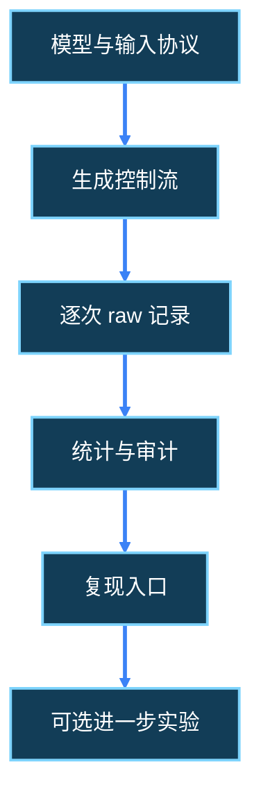

---
source_files:
  - nanochat/engine.py
  - .agents/docs/career_roadmap/w3/scripts/d15_prepare_materials.py
  - .agents/docs/career_roadmap/w3/scripts/d13_aggregate.py
  - .agents/docs/career_roadmap/w2/scripts/d12_benchmark.py
doc_type: tutorial
knowledge_role: supporting
knowledge_scope: W3第7日学习与实践
---

# W3 D7 · 三分钟介绍与证据图

[上一日](d20_reproduction_entry.md) · [后续周次总计划](../nanochat_daily_execution_2026-10-01.md)。

## 当天的流程阅读

先用约 10–20 分钟读下面指定的小节，再回到当天操作；已读内容按问题回查即可。阅读只需口述理解，不新增手写报告或实验产物。

- **阅读入口**：[1.1 整体训练主线图](../../llm-training-workflow/01-training-pipeline-and-optional-branches.md#reading-1-1)；[11.5 保存、评价与下一阶段](../../llm-training-workflow/11-supervised-fine-tuning.md#reading-11-5)；[14.1 提示、生成、奖励与有效目标](../../llm-training-workflow/14-gsm8k-reinforcement-learning.md#reading-14-1)；[15.3 交付资产与部署边界](../../llm-training-workflow/15-running-examples-and-delivery.md#reading-15-3)。
- **今天重点**：先用主线图串讲已做的实验，再把 <abbr title="SFT / Supervised Fine-Tuning · 监督微调；用示范对话中的助手目标更新基础模型。">SFT</abbr> 产物与可选数学奖励训练放到正确位置。<abbr title="RL / Reinforcement Learning · 强化学习；此处指利用生成回答的数学奖励进一步更新模型。">RL</abbr> 小节先读输入、生成回答和奖励的关系，不展开更新公式。
- **暂时跳过**：RL 算法、SFT 深入继承、多卡通信和 <abbr title="FP8 · 8 位浮点计算；本项目的可选训练加速方式，需要兼容硬件。">FP8</abbr> 内核不作为 D21 验收要求；以后按方向深读。

**读完能解释**：能否从文本、分词、训练、权重、生成、评估讲到交付，并逐段指出已做、仅理解和仍待验证的部分？可直接在聊天中回答，再用本日原有自验证问题核对实际实验。

## 今天学什么，做到哪里算完成

今天把三周学习压缩成一段可追问、可查证的项目介绍，约 60–90 分钟。**不补训练、不补 GPU 测量**；MiniMind 历史材料有真实参与和证据时才加入。主线是用自己的话讲清一个机制、一项本人动作和证据范围。

前置是自己的简历初稿内容与 D20 复现入口；需要展示运行成果时再选真实 raw/CSV/audit。只有纸面推演就介绍理解与设计，不能照抄示例称已运行。介绍可直接在聊天完成，讲稿和图文件可选；缺少尚未执行的主线操作则如实说明，不靠日历自动打勾。

## 1. 从“列技术名词”改成“讲一个判断过程”

假设开场是“我学习了 Transformer、KV Cache、TTFT、P95”。听众知道你见过这些词，却不知道你理解了什么。把它改成一个具体问题：“同样生成四个 token，为什么有人报告整体吞吐，有人只报告后续解码吞吐？”

用 P=8/G=4/B=1 的纸面过程回答：prefill 处理八个输入位置得到首个预测，之后三次输入生成 token 得到三个后续预测；所以四个输出对应三个后续间隔。首个等待 30ms、后续各 10ms 时，整体是 `4/0.060≈66.67 token/s`，后续部分是 `3/0.030=100 token/s`。两个分子和时间范围不同，数字不能直接比较。这些是假设数值。

再接本人动作：“我对照包装器的 `elapsed=sum(times)` 与有效计数，确认它采用包含首个等待的整体吞吐。”只有真正读懂时才这样说；若实际运行过，再补原始行与复算。这样听众能追问你的依据，而不是只检查名词定义。

## 2. 带读：如何把源码结论和运行结论接起来

按问题查看三处代码即可，不重读全仓库：

| 要解释的问题 | 源码入口 | 能推出什么 |
|---|---|---|
| 首个输出怎样出现 | [Engine.generate](../../../../nanochat/engine.py) 的 prefill 与首个 yield | 首个预测来自提示末位置，后续复用缓存；这属于机制解释 |
| 本次时间覆盖哪里 | [measure](../w2/scripts/d12_benchmark.py) 的首次 next、times、counts 与 close | 包装器的计时/计数定义；是否实际跑完须看 raw |
| 一句统计怎样追证据 | [聚合工具](scripts/d13_aggregate.py) 的 metrics、groups 与 audit | 哪些行按什么定义纳入，汇总如何形成；不能独立证明 raw 的执行真实性 |

<abbr title="证据链 · 让一句结论能沿统计组、审计记录与原始运行追溯；每个节点都有真实来源和适用范围。">证据链</abbr>可以逆着走：一句结论 → CSV 的组和 run_ids → audit 的 file/line/run_id → raw 的输入、实际计数和时间 → 对应版本的源码。不要从汇总跳过原始行，也不要把源码描述当作已经执行的证明。

例如“完成 CPU 随机模型测量链路核查”需要本人运行/复核动作、真实设备与模型类型、有效样本数和反查记录；“实现缓存优化并加速 X%”还需要本人修改、正确性验证和同条件对照。前一句有明确技术内容，也更符合当前学习范围。

## 3. 把内容放进三分钟

下面是组织方式，不是要求背诵的讲稿；内容按自己实际完成范围填写。

| 时间 | 讲什么 | 应展示的依据 |
|---|---|---|
| 0:00–0:30 | 一个具体问题与本人角色 | 阅读解释、运行复核或自己新增，动词明确 |
| 0:30–1:15 | 用刚才的四 token 例子解释机制 | 纸面过程与真实代码位置，注明是假设 |
| 1:15–2:15 | 讲一项真实核查：输入、方法、结果 | 若实际运行则展示 raw/统计；否则讲清推演和实验设计 |
| 2:15–3:00 | 解释结论范围，选择一个下一步 | 针对真实缺口给可执行动作与成功判据 |

只有自己实际跑过相应实验，才可采用这类句式：“在 CPU 随机小模型上，我用固定 P/G/B 做重复生成，保留预热和正式行，并从 audit 反查有效样本。它支持该环境下的生成与测量契约检查；没有语言质量或 GPU 性能结论。”其中次数、设备和计数要从自己记录取，不借用教程维护者的临时验证。

下一步也应按资源和问题选择：还没解释清 raw，就先复算一条；已能复算，就检查一个失败或上下文边界；想研究性能且已有可比测量，再考虑 <abbr title="Profiler / 性能分析器 · 记录算子、调用和耗时事件以定位候选瓶颈；采样有额外开销，trace 时间不能直接混入普通基准。">profiler</abbr>。不自动把租卡、训练或某个内核优化排为必做。

## 4. 用一张图检查有没有跳过证据

图只组织关系，不表示全部节点已完成。每个节点在聊天说明“已运行复核 / 仅阅读推演 / 未选择的扩展”，并只引用实际存在的文件。图文件可选，阅读器不支持 Mermaid 时用下方表格说明即可。



| 节点 | 应能回答的检查问题 |
|---|---|
| 模型与输入协议 | 随机初始化还是加载权重？P/G/B 和 token 构造是什么？ |
| 生成控制流 | prefill、缓存复制、yield 和下一次前向如何衔接？ |
| raw | 本人实际执行/复核了哪些行，失败是否保留？ |
| 统计与审计 | 哪些 run 纳入、预热和正式各多少，P95 用什么方法？ |
| 复现入口 | 另一个终端能否按正文重测或重建统计？ |
| 可选进一步实验 | 是否真的选择了；没有选择就不记每日欠账 |

如果选择训练权重，再在模型节点补文本→tokenizer→训练→checkpoint 的来源；这条知识流程可以解释而未执行。<abbr title="SFT / Supervised Fine-Tuning · 用示范数据中的目标位置更新模型参数的监督微调；属于训练阶段，不是生成推理。">SFT</abbr> 与 RL 属于可选训练阶段，不能因知道位置就声称做过训练。MiniMind 归档只支持那个历史版本与本人核查范围，不自动替代 nanochat 当前记录。

## 5. 实际讲一遍，再按需生成讲稿

用手机或系统计时器讲一遍，约三分钟；超时优先删背景和名词堆叠，保留问题、本人方法和证据范围。把实际耗时、口述要点和一个答不清的追问发在聊天即可。不要把教程时间表当成自己已经计时。

想保留文件时才运行材料工具；它不执行模型、不发送消息：

```bash
cd /home/lizishuo/_program_/Project/nanochat
mkdir -p experiments/inference_infra/reports
{
python .agents/docs/career_roadmap/w3/scripts/d15_prepare_materials.py \
  --kind briefing --output-dir experiments/inference_infra/reports/w3_briefing_v1 \
  --evidence experiments/inference_infra/reports/w3_reproduction_v1/d20_reproduction_entry.md
D21_RC=$?
printf 'briefing_materials_exit=%s\n' "$D21_RC"
} > >(tee -a experiments/inference_infra/reports/d21_checks.log) 2>&1
```

仅在实际完成 D20 正文后引用该 evidence；其他真实 raw/CSV 可另加参数。缺失会登记 `exists:false`，不是通过；材料脚本返回 0 也不证明口述完成。已有稿件会拒绝覆盖，继续编辑或用 v2。

## 6. 收尾时检查三份材料是否讲同一件事

把简历、复现入口和口述放在一起核对：本人动词一致、模型与设备一致、样本数和统计范围一致、没有把推演写成实测。CPU 主线可以独立完成本周；GPU/训练扩展未选不标待补。已经选择但失败的操作如实保留失败，主线尚未执行也不冒充完成。

不要求额外 gate 报告；聊天给出“已理解 / 已执行复核 / 尚未执行的主线 / 未选择的扩展”及证据即可。可选保存 `d21_w3_gate.md`。本日不包含导师邮件、公开发布或上传个人材料。

## 本日脚本与产物清单

路径相对于项目根目录；材料和自动日志只有执行相应命令后生成。其他原始记录沿用首次生成日名称。

| 脚本完整路径 | 用途与输入 | 条件 |
|---|---|---|
| [.agents/docs/career_roadmap/w3/scripts/d15_prepare_materials.py](scripts/d15_prepare_materials.py) | 可选 briefing 骨架、真实 evidence 清单 | 标准库、新稿件目标；不运行模型 |
| [.agents/docs/career_roadmap/w2/scripts/d12_benchmark.py](../w2/scripts/d12_benchmark.py) | 本日只读计时边界 | 复用已有 raw，不要求重测 |
| [.agents/docs/career_roadmap/w3/scripts/d13_aggregate.py](scripts/d13_aggregate.py) | 本日只读统计和 audit 逻辑 | 复用 D19 结果 |

| 产物完整路径 | 生成者 | 条件与含义 |
|---|---|---|
| `experiments/inference_infra/reports/d21_checks.log` | 局部命令组 tee | 输出、错误与退出码，不持续记录终端 |
| `experiments/inference_infra/reports/w3_briefing_v1/d21_project_briefing.md` | 材料工具后本人编辑 | 可选；聊天口述要点可替代 |
| `experiments/inference_infra/reports/w3_briefing_v1/d21_briefing_evidence_inventory.json` | 材料工具 | 文件存在性/指纹，不证明结论与口述完成 |
| `experiments/inference_infra/reports/d21_w3_gate.md` | 本人自愿整理 | 可选收尾状态，聊天核对可替代 |

## 本日自验证与交流

1. 实际计时讲一遍，再给出口述要点与耗时。听众能否指出你研究的问题和本人做过的动作？

   **核对要点**：自己的话、实际计时；没有运行证据就讲理解与设计，不编造排障经历或收益。

2. 从介绍里挑一句结论，沿“CSV→audit→raw→代码”反查。只有阅读结论时，明确链路在哪停止。

   **核对要点**：文件、行号、run_id 与组对应；不只列路径，说明原始值为什么支持那句话。

3. 听众问“所以你已经证明模型更强、GPU更快？”你如何根据现有证据回应？

   **核对要点**：区分机制理解、功能正确性、系统性能与能力评价，顺便检查简历与复现正文有没有越界用语。

4. 另一位同学明天接手，应先做哪个动作？给出入口、资源和可检查的成功判据。

   **核对要点**：针对真实缺口选择一个动作；现有 CPU 资源也能推进，不泛说“继续优化”。

## 完成核对

- [ ] 能用具体例子和真实代码解释一项机制。
- [ ] 三分钟介绍与简历、复现正文的事实范围一致。
- [ ] 已执行、仅推演和未选扩展分清；材料整理不代替读者学习验收。
