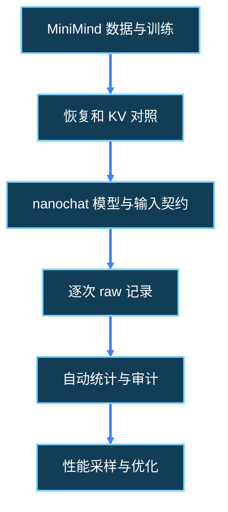

---
source_files:
  - nanochat/engine.py
  - nanochat/gpt.py
  - nanochat/checkpoint_manager.py
  - nanochat/flash_attention.py
  - scripts/infer_bench.py
  - tests/test_engine.py
  - tests/test_attention_fallback.py
doc_type: tutorial
knowledge_role: supporting
knowledge_scope: W3第7日实操与验收
---

# W3 D7 · 三分钟介绍与证据图

[上一日](d20_reproduction_entry.md) · [后续周次总计划](../nanochat_daily_execution_2026-10-01.md)。

## 开始前：固定终端和记录方式

本日命令均从 nanochat 仓库根执行。先打开终端，激活已创建的 Conda 环境；若新终端提示找不到 `conda`，先运行 `source /home/lizishuo/miniconda3/etc/profile.d/conda.sh` 再激活，不创建另一个 `.venv`。

```bash
conda activate nanochat
cd /home/lizishuo/_program_/Project/nanochat
python -c "import sys; print(sys.executable)"
git status --short
mkdir -p experiments/inference_infra/reports experiments/inference_infra/results/raw experiments/inference_infra/results/summary
exec > >(tee -a experiments/inference_infra/reports/d21_checks.log) 2>&1
```

解释器应指向 `/home/lizishuo/miniconda3/envs/nanochat/bin/python`。依赖是否已装好要另查，激活成功不代表 PyTorch 可用。保留已有改动，遇到未认识的变更不要还原。教程脚本保存在本周 `scripts/`，结果写入 `experiments/inference_infra/`，两者不能混为同一类产物。

在 `experiments/inference_infra/reports/d15_experiment-log.md` 末尾追加当天日志，记录实际执行日期；标题里的 W3 Dn 是学习顺序，补做时不能倒填为此前已完成。

```text
学习槽位：W3 / 当日标题编号
实际开始与结束：
解释器、git commit、相关源码是否有未提交改动：
命令（完整参数）与退出码：
输入来源 / 产物路径：
观察到的事实：
尚未验证 / 阻塞原因：
下一步 / 下次检查时间：
```

## 今天的目标（约 3 小时）

W3 收尾不以优化数字为目标，而是能展示一条从训练产物到可信测量的证据链。前置：昨天的复现正文、简历初稿、矩阵状态和原始结果。<abbr title="Evidence chain · 证据链；每个叙述能回溯到具体输入、源码、执行日志和原始记录，而不是仅引用另一份总结。">证据链</abbr> 要让导师能判断你到底做到了哪一步，不要求没有 GPU 时编造 GPU 效果。

分配：30 分钟整理文件，40 分钟写讲稿，30 分钟画图，30 分钟计时口述，30 分钟核查 W3 gate。

## 第一步：生成讲稿骨架

使用[材料准备脚本](scripts/d15_prepare_materials.py)，附上实际报告；无需今天发送任何邮件或联系他人。

```bash
python .agents/docs/career_roadmap/w3/scripts/d15_prepare_materials.py \
  --kind briefing --output-dir experiments/inference_infra/reports/w3_briefing_v1 \
  --evidence experiments/inference_infra/reports/w3_reproduction_v1/d20_reproduction_entry.md \
  --evidence experiments/inference_infra/results/summary/d19_baseline.csv
```

打开 `d21_project_briefing.md`，按时间段填写。没有 d19_baseline.csv 时在清单保留缺失并在讲稿说“尚无实测基线”，不要把缺失读成零延迟。<abbr title="Baseline · 基线；后续优化前固定条件下的测量参照。没有原始样本和方法约定的单次数字不能充当可信基线。">baseline</abbr> 是后续变化的参照，不等于优于上游或完成优化。

## 第二步：逐段写成自然语言

0:00–0:30 用两句说清问题与本人贡献：“我从小模型训练复现转到推理基础设施，先关注缓存正确性和测量可信性。当前亲自完成/复核的是……”。根据实际参与情况选择动词，不把已有产物阅读说成从头实现。

0:30–1:15 展示 MiniMind 的一个真实证据，比如新进程恢复日志或 KV 一致性 CSV。说明 CPU、小模型、小数据的边界；归档已搬迁，演示前点开新路径，不能点击旧链接失败后口头宣称证据在别处。

1:15–2:15 解释 nanochat 两条生成路径：GPT.generate 每步把完整历史重新前向；Engine.generate 先 batch1 prefill，再复制缓存到样本行并逐步 decode。解释 TTFT 计时含什么、有效 token 怎样计数、为什么要预热3次正式5次。没有真实 GPU结果就展示矩阵默认计划、CPU raw与自动统计，让证据本身说明当前阶段。

2:15–3:00 讲限制与下一步：“CPU契约不证明GPU性能；下一步在同模型同条件下补基线并采集 profiler，依据 trace 决定优化点”。<abbr title="Profiler / 性能分析器 · 记录算子、调用和耗时事件的工具；采样trace帮助定位候选瓶颈，其额外开销使采样耗时不能直接混入普通benchmark。">profiler</abbr> 是定位工具，尚未采样时不能预言已发现 RMSNorm 瓶颈。

## 第三步：制作一张能点击的证据图

在讲稿中加入下面图形骨架；这是信息组织示例，节点不能自动表示已完成。用相邻文字为每个节点标记 `VERIFIED_CPU`、`PENDING_GPU` 或 `PLANNED`，再补实际产物链接。若 Markdown 阅读器不支持 Mermaid，保留节点表即可，不为此安装绘图库。



图下写六行表：节点、状态、对应文件、该文件证明什么、不能证明什么。MiniMind 归档节点链接到真实归档报告；nanochat raw 节点链接到具体 JSONL；统计节点链接到 d19_baseline.csv/audit；最后的优化节点若未做就写 PLANNED，不链接空文件。

## 第四步：计时讲一遍，回答追问

用手机或系统计时器口述，目标约三分钟。超过时间先删背景宣传，不删工作边界。至少能够不看稿回答：

- 为什么 Engine 的 B4 不是四条独立 prompt？
- TTFT 为何不完全等于纯 prefill kernel 时间？
- 为什么 terminal/forced/padding token 不直接计入有效输出？
- 5 个样本的 P95 是什么，能否当稳定尾延迟？
- CPU通过哪些路径，FA3还有什么未验证？
- 没测得加速时，当前成果是什么？

回答应指向脚本和原始字段。不能回答的题回到前一天原理与代码，不在讲稿中堆术语遮掩。比较方法、负结果与边界同样可以展示工程能力。

## 第五步：执行 W3 gate

在 `experiments/inference_infra/reports/d21_w3_gate.md` 写清这四类状态：材料已完成、CPU已验证、GPU待执行、明确失败。检查简历、复现正文、讲稿和 CSV 说法一致；没有把随机模型 CPU结果称成训练checkpoint GPU性能。

```text
一页可编辑简历：路径、待本人补填项
MiniMind证据：归档路径、核对范围、当前源码未复测边界
nanochat最短入口：命令、模型来源、实际验证设备
矩阵：可行/非法上下文/成功/失败/PENDING_GPU数量
统计：raw路径、有效样本数、audit路径、未测项
三分钟讲稿与证据图：路径、口述耗时、答不出的追问
下一阶段：先补基线与trace；现实资源缺口及下一检查时间
```

## 验收与进入下一周

至少展示一个可信 CPU 闭环或明确依赖阻塞，以及 nanochat 可运行入口的实际检查；只有 GPU 数据真实存在时才展示 GPU基线。没有通过门槛的任务按总计划顺延，不能因到10月21日自动打勾。导师邮件、外部发布和上传个人材料不属于今天默认执行内容；本日完成可审阅草稿即可。

## 本日脚本与产物清单

下列路径以项目根目录为基准；脚本编号保留首次使用日。外部历史归档与上游 checkpoint 原生文件名保留，按正文真实绝对路径或环境变量解析；不冒充项目新产物。<abbr title="条件生成：只有指定分支执行、前置文件满足且实际写入后，文件才算存在；清单中的目标路径本身不证明生成成功。">条件生成</abbr>须在验收时核对。只打印的检查统一进入本日 checks 日志，不另称生成报告。

| 脚本完整项目相对路径 | 用途 | 阶段 | 输入路径或来源 | 运行条件 |
|---|---|---|---|---|
| [.agents/docs/career_roadmap/w3/scripts/d15_prepare_materials.py](scripts/d15_prepare_materials.py) | 生成可编辑材料与文件哈希清单 | 第1步 | 正文 --evidence 指定的真实文件；允许缺失并登记 | Conda nanochat；新输出目录，无需 GPU |

| 产物完整项目相对路径 | 用途 | 生成者/步骤 | 生成方式与条件 |
|---|---|---|---|
| `experiments/inference_infra/reports/d21_checks.log` | 环境、只读检查、命令输出及错误 | 开始前 Bash 的 exec / tee | 自动捕获后续终端输出；退出码人工记入日志 |
| `experiments/inference_infra/reports/d15_experiment-log.md` | 每日事实、退出码和阻塞 | 人工追加；跨日复用首次文件 | 人工编写 |
| `experiments/inference_infra/reports/w3_briefing_v1/d21_project_briefing.md` | 本日可编辑材料正文 | d15_prepare_materials.py 对应 --kind | 自动生成骨架，人工完善与验收 |
| `experiments/inference_infra/reports/w3_briefing_v1/d21_briefing_evidence_inventory.json` | 输入存在性、SHA-256及首次归属日 | d15_prepare_materials.py | 自动生成；文件存在不等于结论通过 |
| `experiments/inference_infra/reports/d21_w3_gate.md` | 周末四类状态与证据验收 | 第5步 | 人工编写 |

## 核对记录与完成标记

本文基于当前仓库相关生成、加载、注意力路由及原基准代码编写；源码阅读不能代替执行。本教程的交付状态不表示读者已经完成当天实验。填写实际日志后再勾选：

- [ ] 输入条件与前一天产物已核实。
- [ ] 本日命令在明确设备执行，或具体阻塞已记录。
- [ ] 日志、原始输出与材料保存到所写位置。
- [ ] 示例数值与真实结果已区分，失败和待测未删除。
- [ ] 能说明本日证据证明什么、尚不能证明什么。
